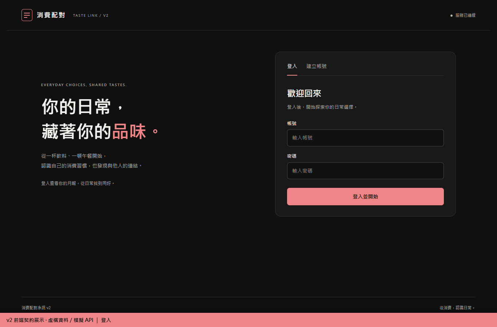
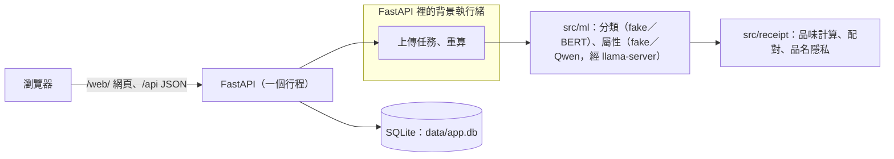
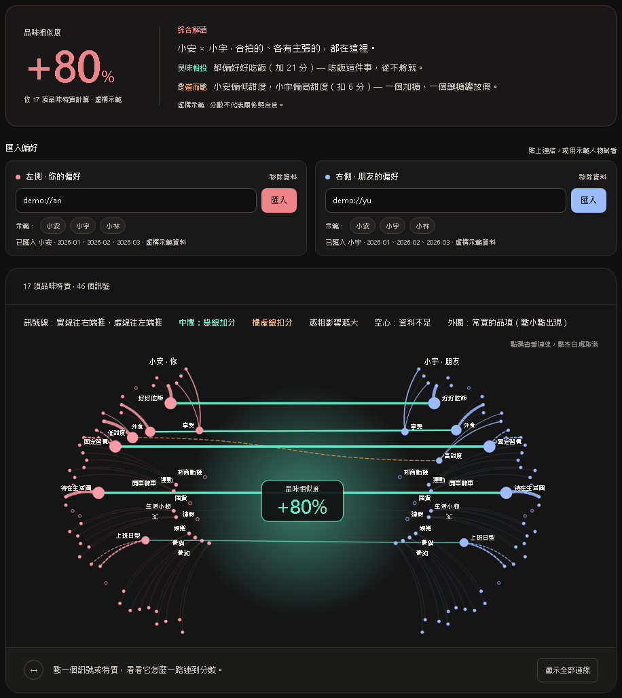

# You are what you buy.

## v2 本機應用

登入後只有兩個選項：**看自己的品味**、**跟陌生人配對品味**。月報以五個章節呈現品項金額、消費節奏、漂浮文字雲、日期分布與月份比較；配對選人後顯示放大的連線圖與精簡綜合解讀，需要時才展開計算明細。上傳與帳號管理放在右上角設定。

FastAPI 在同一個服務提供網頁與 API，資料保存在本機 SQLite；v2 需啟動服務，GitHub Pages 只提供下方標示的 v1 原型。

### 展示動圖



2026-10-17 新版九幕展示。畫面使用已提交的虛構資料，全部 API 回應由錄製腳本模擬；粉紅底標示展示狀態。這是介面導覽，不代表真模型或 300 人整合驗收。[展示與 Docker 驗收紀錄](docs/results/role4-delivery.md) 另列真實 HTTP 驗證結果。

### Docker 啟動（建議展示使用）

v2 已合併到 main。用 `git clone https://github.com/lee851104/receipt.git` 取得程式碼後，先安裝並啟動 Docker Desktop（Linux containers），在**專案根目錄**執行：

```powershell
docker compose up --build -d
```

第一次會建置映像並安裝套件（映像檔含 CPU 版 torch，約 1.7 GB），需要網路；預設分類是 `fake`、屬性是 `qwen`，**不下載模型、不需要 GPU 或本機 Python**。不必建立 .env，容器會在資料 volume 產生簽章密鑰。已有 .env 時，Compose 會讀取其中的模型設定；要固定成預設值，可先設定：

```powershell
$env:CATEGORY_MODEL = "fake"
$env:ATTRIBUTES_MODEL = "qwen"
```

開啟 [v2 網頁](http://127.0.0.1:8000/web/) 或 [API 文件](http://127.0.0.1:8000/docs)。健康檢查位於 [api/health](http://127.0.0.1:8000/api/health)。若主機沒有啟動模型服務，`gpu_mode` 為 false，`models.attributes` 為 `cache_only`（只用快取裡的答案，新品名標「待分析」）。

```powershell
docker compose logs --tail=30 app
docker compose down
docker compose up -d
```

日常停止使用 `docker compose down`，再次 up 可恢復；需要保留展示資料時不要加 `-v`。帳號、發票與容器產生的簽章密鑰在 db volume，模型位置在 models volume。Compose 不會把主機或 .env 的 JWT_SECRET 傳入容器。

拉取新程式後用 `docker compose up --build -d` 重建映像。若資料表欄位或索引改變，目前沒有自動資料庫遷移；可在**已備份需要保留的資料，並確認可清空這個展示環境**後，執行 `docker compose down -v`，再執行 `docker compose up --build -d`。這會刪除該專案的 **db 與 models 兩個 volume**，帳號、發票、簽章密鑰與下載模型全部重建，既有登入 token 失效；要保留舊資料時，先由維護者提供遷移方式，不能直接清空。

埠維持綁定 `127.0.0.1`：DEMO_MODE=1 時任何連得到服務的人都能用示範帳號登入。 8000 若已被其他程式占用，可將 docker-compose.yml 的埠映射改成 127.0.0.1:8002:8000，並以 8002 開啟網頁。

**示範帳號（10/18 整合版）：** `DEMO_MODE=1` 時，容器每次啟動都先放入 300 位唯讀示範帳號，連同他們的購買紀錄和品味向量（profile），做完才開始服務；資料已經完整就跳過。在開發電腦上，容器第一次啟動約 17 秒、之後約 6 秒就能用（見[整合驗收](docs/results/integration-acceptance-20261018.md)）。舊 volume 裡只有舊映像檔放的 40 位空帳號時會補到 300 位。第一次啟動做到一半被中斷時，下一次啟動會先把留下的未完成工作標成失敗，再補完示範帳號。放不進去時（例如帳號和示範名單對不上）只記一行 `demo users not updated: ...`，伺服器照常啟動；`DEMO_MODE=0` 時什麼都不放。seed 的訊息說「Delete the database file and run the seed again」時，在 Docker 裡指的是 `docker compose down -v`，會一起刪掉所有帳號、簽章密鑰和下載的模型。示範帳號的屬性答案是審核過的虛構答案（`datasets/synthetic/attribute-cache.jsonl`，放在映像檔裡）；屬性模型版本（`MODEL_VERSION`）改了之後，要等角色 3 把這份答案重新審核成新版本，下一次啟動才會重放，在那之前每次啟動都會記那一行警告，示範品名顯示「待分析」。

### 模型設定與容器連線

設定來源與完整契約見 [團隊總覽第 5.10 節](docs/team/overview.md#510-設定envrepo-只放-envexample)。

- **屬性（`ATTRIBUTES_MODEL`）：** `docker-compose.yml` 和 `.env.example` 的預設是 `qwen`；`Settings` 本身沒設時是 `fake`，已經有的 `.env` 照舊（寫 `fake` 時示範帳號的品名都是「待分析」，要自己改成 `qwen`）。容器預設連到主機的 `http://host.docker.internal:8080`，可用 `DOCKER_LLAMA_SERVER_URL` 覆寫；容器不用 .env 的 `LLAMA_SERVER_URL`，因為主機的 127.0.0.1 在容器內代表容器自身。位址只從設定來，`qwen` 只接受 `http://` 開頭、主機是 `localhost`、`127.0.0.1`、`[::1]` 或 `host.docker.internal`、沒有路徑和密碼的位址，其他位址讓服務啟動時用一行 `error: ...` 停下來（不印位址）。有 llama-server 回應時，上傳和分類輸入框裡的新品名會一個一個送到這個本機服務判斷；連不到時顯示 `cache_only`，只用快取。health 的 `gpu_mode` 表示服務能否連到 llama-server，與 fake/qwen 設定分開。
- **分類（`CATEGORY_MODEL`）：** 預設 `fake`。`bert` 載入 `CATEGORY_MODEL_DIR` 裡已驗證的 BERT 推論包（角色 2，10/18 整合）；資料夾不完整、標籤或雜湊不符時分類器顯示 `unavailable`（即時分類回 503），其餘服務照常。權重不公開：放在受保護的 Hugging Face Space，固定 revision 和 SHA-256。容器第一次啟動要下載時，用 `docker-compose.category.yml` 疊在基本設定上，設 `CATEGORY_MODEL_REPO`、40 位的 `CATEGORY_MODEL_REVISION`、`CATEGORY_MODEL_SHA256` 和 `HF_TOKEN_FILE`（主機上權杖檔的路徑，以唯讀 secret 掛進容器，不進 .env、Git 或映像檔）；`CATEGORY_MODEL_REPO_TYPE` 必須是 `space`，`bert` 加 repo 卻用 `model` 會在啟動時被拒絕。下載失敗時服務照樣啟動，分類器 `unavailable`；已有驗證過的模型時，重啟不需要憑證和網路。只有容器會下載，start.bat 和直接跑 uvicorn 只讀本機資料夾。細節見[分類服務交付](docs/results/classification-service.md)與[審核修正](docs/results/classification-review-fixes.md)。

### Windows Python 啟動

需 Python 3.12（Node 24 僅前端開發／測試需要）。在專案根目錄執行：

```powershell
py -3.12 -m venv .venv
.venv/Scripts/python.exe -m pip install -r requirements.txt
.venv/Scripts/python.exe --version
```

接著雙擊 start.bat；它會在沒有 .env 時從 `.env.example` 建立設定與隨機密鑰（屬性模型為 `qwen`）、放入 300 位示範帳號和他們的購買紀錄與 profile（完整時跳過；上一次被中斷留下的示範工作會先標成失敗再補完），然後開啟 http://127.0.0.1:8000/web/。示範帳號放不進去時只印一行「示範帳號沒有更新：…；繼續啟動伺服器」；設定寫錯時伺服器自己會用一行訊息停下來。保持啟動視窗開啟，停止按 Ctrl+C；已有 .env 不會覆蓋。不要使用 uv sync（pyproject.toml 未列服務套件）。start.bat 固定使用 127.0.0.1:8000；這個埠被別的程式占用時，先關掉那個程式，或改用上面的手動指令並換一個 `--port`。

**示範上傳（10/18 補上）**：start.bat 預設的分類模型是 `fake`，它只認得少數字（茶、咖啡、餅乾、雞蛋、衛生紙…），真實發票的品名大多會被歸到 10「待確認」而不計入，新帳號就會顯示資料不足。示範時可以先產生一份虛構的電子發票 CSV 再從設定上傳：

```powershell
.venv/Scripts/python.exe -m scripts.make_demo_upload --month 2026-06
```

它寫出 `demo-upload-2026-06.csv`（40 行、品名都是審核過的「示範…」名稱，不進 git），上傳後月報就有內容，也配得到示範帳號；換 `--month` 可以多產生幾個月。要分類自己真實的發票，請改用下面的 BERT。

要在虛擬環境用真的 BERT：另外安裝 `requirements-docker.txt`（CPU 版 torch、transformers），把已驗證的推論包放在 `models/category`（或 `CATEGORY_MODEL_DIR` 指的資料夾），再把 .env 的 `CATEGORY_MODEL` 改成 `bert`。start.bat 和 uvicorn 不會下載模型。

若偏好 uv，可用以下方式建立環境並安裝相同依賴：

```powershell
uv venv --python 3.12 .venv
uv pip install --python .venv/Scripts/python.exe -r requirements.txt
```

手動啟動時，先把 .env.example 複製成 .env 並設定至少 32 字元的隨機 JWT_SECRET，再依序執行（僅一個 worker）：

```powershell
.venv/Scripts/python.exe -m src.api.seed
.venv/Scripts/python.exe -m uvicorn src.api.main:app --host 127.0.0.1 --port 8000
```

若出現 No Python at，代表 .venv 指向的基底 Python 不可用，單純看到 Scripts/python.exe 檔案不表示環境可執行。先安裝或修復對應 Python 3.12，再建立新的虛擬環境；開發中的共用 .venv 不要直接刪除。Docker 方式不依賴這個環境。

### 重錄展示與驗證

已有 Playwright／Chromium 的 Node 環境及 Python 服務依賴時：

```powershell
.venv/Scripts/python.exe -X utf8 tests/run_web_v2_live.py scripts/capture_v2_demo.cjs
.venv/Scripts/python.exe scripts/build_v2_demo_gif.py
```

第二行需要 Pillow（可在獨立工具環境安裝）。錄製服務使用臨時資料庫，結束自動關閉；腳本攔截全部 /api/ 請求，中間截圖與 manifest 留在被忽略的 runtime/，成品只有 docs/assets/v2-contract-demo.gif。可用 NODE_PATH、BROWSER_EXECUTABLE 指定既有 Playwright 與 Chromium。

- [向量化、內積、餘弦與收縮項](docs/team/concepts.md)：兩位虛構人物的 +82% 範例，可由 explain API 重現。
- [團隊總覽與 API 契約](docs/team/overview.md)。
- [前後端整合紀錄](docs/results/role4-integration.md)；[本輪展示與 Docker 交付驗收](docs/results/role4-delivery.md)。
- .venv/Scripts/python.exe -m unittest discover -s tests：後端與核心；node --test "tests/*.test.cjs"：前端與 v1。
- .venv/Scripts/python.exe -X utf8 tests/run_web_v2_live.py：隔離 SQLite、fake 模型、真正 HTTP 與瀏覽器流程。
- GitHub Actions 使用 Python 3.12／Node 24，執行測試、建置與檢查容器（映像檔裡沒有私人檔案；compose 啟動後 `models.attributes` 是 `cache_only`、有 300 位示範帳號，第一位和最後一位登入後 profile 都是 ready、沒有待分析品名）；不下載模型。

各角色分支的審核、本機整合（`role-1/integration`）和合併 main 是不同階段；目前狀態見團隊總覽第 13 節。

## v2 架構與技術選擇

v2 把報告做成一個可以註冊、上傳發票並和朋友配對的服務：一個 FastAPI 行程提供網頁和 API，資料存在一個 SQLite 檔。上方的報告與朋友比較仍是不需要伺服器的單檔網頁（v1），兩者各自獨立。

### 架構



- 上傳的發票在背景執行緒裡依序處理：品名分類、品項屬性、再算出 18 格品味向量存進資料庫；一次只跑一個任務，所以伺服器只能開一個行程（不要加 `--workers`）。
- 模型都放在 `src/ml` 後面，開發時用 `fake` 假模型就能跑完整流程。`llama-server` 沒開時是無 GPU 模式，沒看過的品名標「待分析」。

### 為什麼沒有用 pgvector

pgvector 是 PostgreSQL 的向量搜尋外掛。這個專題沒有用它，理由記在 `openspec/changes/add-matching-system/design.md` 的 D2：

- 品味相似度不是單純的餘弦。`compare` 會略過其中一方沒有資料的格子，還要求至少 5 格雙方都有的雙向格才給分數；pgvector 內建的餘弦做不到這兩件事。
- 用它就得多跑一個資料庫服務，每台開發電腦都要裝；SQLite 只有一個檔案。
- 配對在每次查詢時當場算：300 人 × 18 格不到 1 秒，不需要向量索引。


## v1 靜態原型

以下內容為 v1 原型的功能與歷史技術規劃；v2 以本頁上方與團隊總覽的現況為準。v1 原始檔維持不變。

## 主要功能

製作自己的每月消費回顧（Recap），分析消費習慣，也和朋友比較品味相似度。

## 後續規劃

很少人會為了展現品味，一直買不喜歡的東西。讓日常消費成為認識彼此的起點。

| 規劃功能 | 使用者用途 | 預期延伸效益 |
|---|---|---|
| 配對品味相近的朋友 | 依喜好與生活圈找同好、交友 | 以交友誘因，協助財政部推廣雲端發票使用 |
| 補登無發票消費 | 補足紀錄，解鎖更多配對 | 無發票消費紀錄做為查稅參考依據 |

[開啟 v1 靜態原型：消費洞察＋朋友品味比較](https://lee851104.github.io/receipt/invoice-insights.html)



網頁已內含兩個月的**虛構示範資料**與所需程式，店家、品項、日期及金額皆為合成，不代表任何人的實際消費。只要下載 `invoice-insights.html` 一個檔案，即可離線查看消費報告並切換朋友品味比較，不需要其他網頁、程式或資料檔。

## 使用流程

### 黃金圓（Golden Circle）

| 層次 | 專題的回答 |
|---|---|
| 為什麼（Why） | 從日常消費了解自己，也發現與朋友的共同喜好。 |
| 如何做（How） | 整理發票明細、分類消費，呈現每月變化並比較彼此的消費偏好。 |
| 做什麼（What） | 製作每月消費回顧（Recap）與朋友品味相似度比較網頁。 |

### 操作流程

1. **不用記帳，自動拆到品項**：匯入雲端發票 CSV，讀取明細並分類。
2. **看見自己的消費模式**：用動畫、文字雲、日期圖呈現習慣。
3. **選一個標籤，自己跟自己比**：本月與上月兩欄並排，只呈現改變，不評斷好壞。

## 資料

以下皆為虛構示範，包含折扣、零元贈品與待確認分類，用來展示不同情境。

| 月份 | 明細 | 發票 | 金額 |
|---|---|---|---|
| 2026 年 3 月（示範） | 50 筆 | 48 張 | NT$ 7,910 |
| 2026 年 4 月（示範） | 53 筆 | 51 張 | NT$ 8,095 |

- 示範資料由 `src/receipt/demo.py` 獨立產生，不讀取或改寫私人消費紀錄。
- 分類標籤與配色放在 `configs/report.json`；公開品名對照表也只包含示範品項。
- 沒有 2 月資料，所以 3 月不計算月增減；沒有時分資料，所以不做 24 小時分析。
- `python scripts/build_report.py` 預設產生包含報告與朋友比較的單檔示範版 `invoice-insights.html`，不讀取私人資料。
- 私人原始檔與設定保留在本機 `data/`；含真實資料的 `invoice-insights-private.html` 不納入版本追蹤，可單檔直接分享。

## 分類標籤

共 10 種：正餐、飲品、零食甜點、生鮮食材、運動、其他服務、交通、住宿、日用品、電子產品。

- 「待確認」是審核狀態，不列入比較選單
- `configs/item-categories.json` 包含 23 個虛構示範品名，其中未分類商品標記為暫定
- 沒有對照到的品名，會自動歸為「待確認」

### 與既有雲端發票服務的差別

以下以「雲端發票」應用程式（Application，App）的官方說明為例，不代表所有發票服務都相同。

| 比較項目 | 雲端發票 App | 本專題 |
|---|---|---|
| 分類方式 | 已有商品類別與次類別，也能調整商品所屬分類 | 目前用人工對照表，將品項歸入上述 10 個標籤；自動分類模型仍在規劃 |
| 分類調整 | 使用者可在 App 內變更商品的類別與次類別 | 目前需修改分類對照表；未對應的品項標示「待確認」 |
| 查看消費 | 提供消費圓餅圖，可自訂日期區間查看 | 提供文字雲、日期分布，以及所選標籤的本月與上月並排比較 |
| 資料使用 | 在 App 內查看發票與消費分析 | 目前先將下載的發票資料在本機轉換，再用網頁查看 |

既有服務已能進行商品分類。本專題著重把分類結果整理成容易理解的消費回顧，並呈現自己每月的變化。

參考：[雲端發票官方說明：消費分析、自訂日期與編輯商品類別](https://www.ecloudlife.com/w/faq/4)（查閱日期：2026-10-06）。

## 技術規劃

| 工作 | 技術 | 狀態 |
|---|---|---|
| 讀取與清理 | Python（目前用標準函式庫 csv；規劃改用 pandas） | 部分完成 |
| 品項分類 | 比較 TF-IDF＋邏輯回歸、Embedding＋邏輯回歸、BERT 微調 | 未開始 |
| 儲存與統計 | DuckDB | 未開始 |
| 前端 | HTML、CSS、JavaScript、SVG | 原型完成 |

### 三種分類模型比較

用相同資料比較三種方法，把發票品名分成 10 類。目前尚未實測，F1 待測，成本先列預估。

| 模型 | 做法 | F1 分數 | 成本（預估） |
|---|---|---|---|
| TF-IDF＋邏輯迴歸 | 看品名中的字詞來分類。 | 待測 | 較低，一般電腦即可執行。 |
| Embedding＋邏輯迴歸 | 先把品名轉成代表語意的數字，再分類。 | 待測 | 依向量模型大小而定，需額外計算與儲存向量。 |
| BERT 微調 | 用商品資料調整現成模型，讓它更適合分類品名。 | 待測 | 訓練成本通常較高，需要較多時間與記憶體。 |

**F1**：各類別分數取平均，介於 0–1，越高代表分類效果越好。[評分定義](https://scikit-learn.org/stable/modules/generated/sklearn.metrics.f1_score.html)

**選擇原則**：比較分類效果、執行時間與硬體費用；效果差不多，就選成本較低的。

<details>
<summary>名詞全名</summary>

- TF-IDF：詞頻－逆向文件頻率（Term Frequency–Inverse Document Frequency）。
- 邏輯迴歸：Logistic Regression。
- Embedding：文字向量嵌入（Text Embedding）。
- BERT：轉換器雙向編碼器表示模型（Bidirectional Encoder Representations from Transformers）；微調為 Fine-tuning。
- 本表 F1 採宏平均 F1 分數（Macro-averaged F1 Score）。

</details>

### 專案結構

```text
receipt/
├── README.md                     # 專題說明與操作指令
├── pyproject.toml                # Python 版本與相依套件設定
├── .gitignore
├── invoice-insights.html         # 已內嵌示範資料與程式的公開成品
├── invoice-insights-private.html # 真實資料原版，僅留本機、不上傳
├── presentation.html             # 可直接開啟的兩頁簡報
├── readme_pic.jpg                # 消費洞察預覽圖
├── readme_pic1.png               # README 使用的朋友品味比較預覽圖
├── configs/
│   ├── report.json               # 輸入資料清單、分類名稱與配色
│   └── item-categories.json      # 品名與分類的人工對照
├── src/
│   ├── receipt/
│   │   ├── __init__.py
│   │   ├── demo.py               # 獨立產生虛構示範消費
│   │   ├── invoices.py           # 解析、分類與發票號碼代碼化
│   │   └── build.py              # 整合資料、樣式與程式，產生單檔網頁
│   └── web/
│       ├── invoice-insights.html # 網頁原始模板，不含發票資料
│       ├── styles.css            # 網頁樣式
│       ├── insights-ui.js        # 消費洞察與圖表
│       ├── monthly-comparison.js # 月份比較計算
│       ├── comparison-ui.js      # 比較介面
│       ├── flow-navigation.js    # 三區域導覽
│       ├── taste-comparison.html # 內嵌朋友比較畫面的來源
│       ├── taste-profile.js      # 偏好摘要與分享連結格式
│       ├── taste-export.js       # 報告匯出與比較入口
│       └── taste-navigation.js   # 單檔內的畫面切換與返回
├── scripts/
│   └── build_report.py           # 產生網頁的執行入口
├── tests/                        # 資料、產生流程與前端測試
├── data/                         # 僅留本機，不追蹤到 Git
│   ├── raw/                      # 原始發票 CSV
│   ├── processed/                # 產生的示範 report-data.js
│   └── private/                  # 私人設定、品名對照與備份
└── prototypes/
    └── annual-review.html        # 保留的早期年度回顧原型
```

報表核心程式（`src/receipt/`）只使用標準函式庫，需 Python 3.10 以上；後端（`src/api/`）需要的套件列在 `requirements.txt`；前端測試另需 Node.js。

```sh
python scripts/build_report.py
python -m unittest discover -s tests -v
node --test tests/monthly-comparison.test.cjs tests/comparison-interface.test.cjs tests/taste-profile.test.cjs
```

公開示範版與全部測試都不需要私人資料，可在剛下載的專案直接執行。

若要重新產生自己的報告，先在 `data/private/report.json` 設定 `input_files`（原始 CSV 路徑）、`category_catalog`（私人品名對照表路徑）與 `categories`（分類名稱及配色，可參考公開設定）。所有路徑相對於專案根目錄，再執行：

```sh
python scripts/build_report.py --private
```

此指令只更新 `invoice-insights-private.html`，不覆寫公開示範版。CSV 指逗號分隔值（Comma-Separated Values）檔案，目前接受電子發票匯出欄位，一份檔案一個月。

`data/`、`invoice-insights-private.html` 與未來的 `models/` 已排除版本追蹤。私人版本仍含真實店家、品名、日期與金額，請自行決定分享對象。

目前尚未訓練模型或提供後端服務，因此不建立空的模型訓練、特徵工程、筆記本或服務目錄，待功能實作時再加入。

## 與朋友比較偏好

報告上方可點「比較跟朋友品味差多少」開啟朋友比較，預設以左側小安、右側小宇進行比較，兩側網址欄會自動填入示範人物。按「匯出我的品味連結」會產生你的品味連結，面板會列出朋友會看到的品名，可以先檢查再分享；按「帶到朋友比較頁」會把你放在左側，直接和示範的小宇比較。到[朋友比較畫面](https://lee851104.github.io/receipt/invoice-insights.html#friends)貼上兩人的連結；兩人都有品味特質時顯示品味特質連線圖，圖中間寫著品味相似度；只匯入一人，或連結沒有品味特質時，圖的位置會說明原因。點「返回消費洞察」即可回到同一檔案內的報告。

品味連結包含暱稱、涵蓋月份、10 類已確認品項的筆數、17 項品味特質、各消費訊號的彙總值（例如每餐平均花費、每月 3C 花費、每月次數），以及每個訊號最常買的品名；不包含店名、行政區、地址、日期、單筆金額或發票號碼。品名裡的地名會拿掉，住宿只寫「旅館住宿」，長途交通只寫交通方式。舊版連結只有暱稱、月份與 10 類筆數，仍可貼上，但沒有品味特質，畫不出連線圖。資料放在網址片段（URL Fragment）內，不上傳至伺服器；這不是加密，取得完整連結的人可以讀取這些內容。公開示範版匯出的仍是虛構資料。

品味相似度是兩人 17 項品味特質的餘弦相似度（Cosine Similarity），範圍 −100%～+100%，寫在上方的大字與連線圖中間。圖中間的光越亮，代表分數離 0 越遠（綠光是合拍、橘光是相反）；中間每條線加減的分數越多，線就越亮。

本機 `file:` 連結不能讓朋友直接開啟你的電腦檔案。示範時直接傳送 `invoice-insights.html` 即可；對方下載後可離線操作報告與比較畫面，再把你的完整連結貼進比較畫面。線上示範也使用同一個整合檔案。


## 角色2 CPU BERT 接入（2026-10-17）

（10/18 已整合，設定與下載方式見上方「模型設定與容器連線」。）角色2分支已接上選定的25%合成BERT；CATEGORY_MODEL=bert搭配可信完整模型目錄，失敗時unavailable。安裝requirements.txt及requirements-docker.txt；公開/Protected政策、白名單安裝與實際驗收詳見[分類服務交付](docs/results/classification-service.md)。原測試集封存，現有服務與主工作目錄未自動切換。
