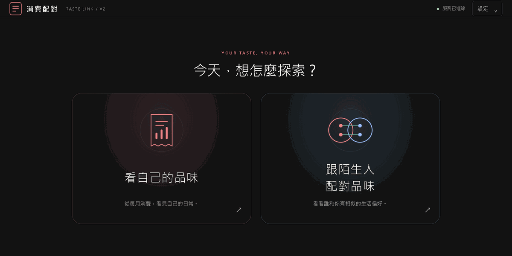
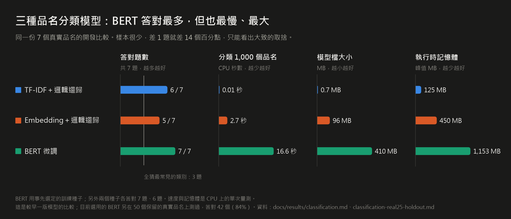
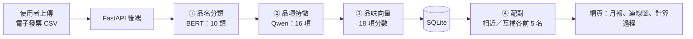

# You are what you buy.

**上傳電子發票，AI 幫你看懂自己的消費品味，再找出品味相近或互補的人。**

[](https://github.com/lee851104/receipt/actions/workflows/ci.yml)

## 1. 解決什麼問題

| 現況的困擾 | 這個專案的做法 |
|---|---|
| 記帳太麻煩，多數人撐不久 | 直接上傳財政部電子發票檔，不用手動記帳 |
| 發票只是一串品名，看不出自己的習慣 | AI 自動把每個品項分成 10 類，整理成每月消費回顧 |
| 交友靠自我介紹，容易美化 | 用實際消費算出 18 項「品味特徵」，配對品味相近或互補的人 |

很少人會為了展現品味，一直買自己不喜歡的東西，所以日常消費是認識一個人很誠實的起點。

**👉 [線上試玩（不用安裝）](https://lee851104.github.io/receipt/demo/)**：選一位虛構的示範帳號，就能看每月消費回顧、配對清單和品味連線圖。這是預先錄好資料的靜態展示版，上傳發票、註冊等完整功能請照[快速開始](#6-快速開始)在本機啟動。

## 2. 使用畫面



動畫依序是：

1. **首頁**：登入後二選一，看自己的品味，或跟陌生人配對
2. **每月消費回顧**：錢花在哪些品項、有消費的天數、各類別的占比
3. **配對清單**：品味相近的人列出前 5 名，也可以切到「互補」，或只看同區、同縣市
4. **品味連線圖（相近 +95%）**：兩人的 18 項品味特徵逐項對照，綠線代表習慣一致
5. **品味連線圖（互補 −51%）**：橘色虛線代表習慣相反，例如一個常外食、一個自己煮

畫面中的人物、店家與消費全部是虛構的示範資料。包含上傳、計算過程與帳號設定的完整導覽見[九幕介面導覽](docs/assets/v2-contract-demo.gif)。

## 3. 用了哪些技術？為什麼？

| 用途 | 技術 | 為什麼選它 |
|---|---|---|
| 網站後端 | Python、FastAPI | 寫法簡單，會自動產生 API 說明頁，方便前後端分工 |
| 資料庫 | SQLite | 整個資料庫就是一個檔案，不用另外架設伺服器 |
| 品名分類（10 類） | BERT 中文模型（微調） | 發票品名短又常縮寫，需要懂語意；和兩種較輕量的方法比較後選用 |
| 品項特徵（含糖、囤貨等 16 項） | Qwen3-4B 本機語言模型、llama.cpp | 在自己的電腦上執行，真實品名不必上傳到雲端 AI；和 8B 版本比較後，4B 更快、分數也較高 |
| 配對 | 加權餘弦相似度 | 分數可以拆成每一項的貢獻，說得出「為什麼配到這個人」 |
| 登入 | JWT、Argon2 | 業界常用的登入憑證與密碼加密方式 |
| 網頁 | HTML、CSS、JavaScript、SVG | 不用框架，由同一個後端直接提供，只要部署一個服務 |
| 啟動 | Docker Compose | 一行指令就能跑起來，評審和面試官不必安裝 Python |
| 自動測試 | GitHub Actions | 每次上傳程式碼都自動跑測試、建置並檢查 Docker 映像檔 |

**為什麼選 BERT？** 三種分類方法在同一份真實品名上比過：BERT 答對最多，代價是比較慢、檔案比較大。



**品味向量存在哪裡？** 每個人的 18 項分數存在 SQLite 的 `profiles` 資料表，一人一列。配對時把其他人的向量讀出來，用 Python 逐一算相似度。

**為什麼不用向量資料庫（pgvector）？** 向量資料庫擅長的是在大量向量裡快速找出最接近的幾個，但我們的配對公式有兩條自己的規則：跳過任一方沒有資料的項目，以及至少要有 5 項雙方都有資料才給分數。資料庫內建的餘弦相似度做不到這兩點。而且 300 人逐一計算不到 1 秒，不需要另外建索引。等使用者多到逐一計算太慢時，再改用 PostgreSQL 加 pgvector 先粗篩出候選人，最後一樣用我們的公式算分數。

## 4. 架構



1. **上傳**：讀取財政部電子發票 CSV，一份一個月；作廢發票和金額不到 10 元的明細（例如折扣）不計入。
2. **分類**：BERT 把每個品名分到正餐、飲品、零食甜點等 10 類，沒把握的標成「待確認」。
3. **品項特徵**：Qwen 判斷每個品項的特徵，例如有沒有含糖、是不是大量囤貨。同一個品名只問一次，答案存進快取。
4. **品味向量**：把一個人的消費整理成 18 項分數，例如「省錢 ↔ 享受」「外食 ↔ 自己煮」，存進資料庫。
5. **配對**：和其他使用者逐項比較，相似度 +30% 以上列為「相近」，−10% 以下列為「互補」。

分類和特徵判斷在背景進行，上傳後網頁會顯示處理進度。

## 5. 工程亮點

- **配對結果說得出原因**：相似度拆成 18 項，每一項「我 × 對方 × 權重」的貢獻都列在計算過程面板，全部加起來剛好等於最終分數。分母另外加上 0.25，避免資料很少的人分數虛高。
- **不只找相似，也找互補**：負分代表習慣相反，另外列成一份「互補」清單，因為交朋友不一定要找跟自己一模一樣的人。
- **隱私優先**：真實發票與品名不進 Git，也不上傳到雲端 AI。配對時，對方只看得到去掉地名的品名，看不到店家、日期和金額。CI 會檢查 Docker 映像檔裡沒有私人檔案。
- **沒有顯示卡也能跑**：每個模型都接在同一套介面後面，可以換成測試用的假模型。沒有 GPU 時只讀快取，新品名先標「待分析」，服務照常運作。
- **評估誠實標出限制**：BERT 在 50 個未用於訓練的真實品名上答對 42 個（84%）；300 位虛構示範用戶中，每個人的相近前 5 名都是同一類型的人。樣本少、示範用戶的習慣是設計出來的，所以報告裡寫明這些數字不能代表真實使用者。
- **測試完整、能從零重現**：570 個 Python 測試與約 150 個前端測試，每次上傳程式碼都自動執行；也在另一台電腦從零下載、照本文件啟動，驗收通過。

## 6. 快速開始

### 方法一：Docker（建議）

先安裝並開啟 [Docker Desktop](https://www.docker.com/products/docker-desktop/)，然後執行：

```bash
git clone https://github.com/lee851104/receipt.git
cd receipt
docker compose up --build -d
```

第一次需要下載與建置，約幾分鐘（映像檔約 1.7 GB）。完成後打開：

- 網頁：<http://127.0.0.1:8000/web/>，選一位示範帳號登入，就能看月報和配對
- API 文件：<http://127.0.0.1:8000/docs>

停止服務：`docker compose down`

### 方法二：Windows 加 Python 3.12

```powershell
py -3.12 -m venv .venv
.venv/Scripts/python.exe -m pip install -r requirements.txt
```

接著雙擊 `start.bat`，瀏覽器會自動打開網頁。

兩種方法預設都用測試用的假分類模型，不需要下載模型或 GPU，300 位示範帳號的資料都已備妥。想試上傳，可以先產生一份虛構發票：`.venv/Scripts/python.exe -m scripts.make_demo_upload --month 2026-06`。換成真的 BERT、接上 Qwen 等設定見[啟動與設定細節](docs/setup.md)。

## 7. 深入閱讀

- [配對公式怎麼算](docs/team/concepts.md)：用兩位虛構人物，一步一步算出 +82%
- [啟動與設定細節](docs/setup.md)：Docker、模型設定、測試與重錄展示
- [團隊總覽與 API 規格](docs/team/overview.md)：分工、決策紀錄、17 個 API 端點
- [系統設計決策](openspec/changes/archive/2026-10-19-add-matching-system/design.md)：每個技術選擇的理由與取捨
- 評估報告：[品名分類](docs/results/classification-real25-holdout.md)、[品項特徵](docs/results/attributes.md)、[配對驗證](docs/results/matching.md)
- [v1 靜態原型](docs/v1-prototype.md)：不需伺服器的單檔版，可以[直接線上開啟](https://lee851104.github.io/receipt/invoice-insights.html)

## 8. 授權

程式碼採用 [MIT 授權](LICENSE)：可以自由使用、修改與散布，只要保留原本的版權與授權聲明。

示範資料全部是虛構的。真實發票、真實品名與模型權重不放在這個專案裡，也不在授權範圍內。
