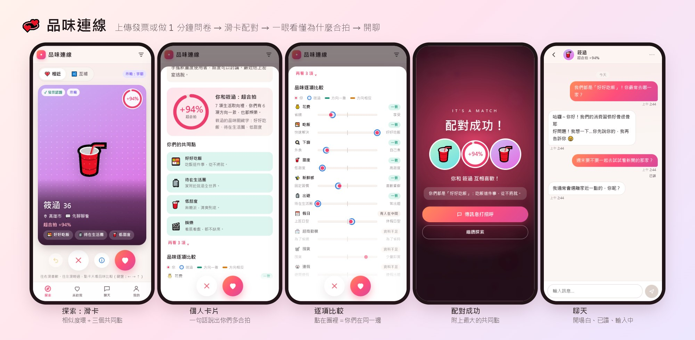

# 品味連線：交友配對 APP

**上傳電子發票（或做 1 分鐘問卷），AI 算出 18 項生活品味，滑卡找到品味相近或剛好互補的人，配對後直接聊天。**

網址：啟動後打開 <http://127.0.0.1:8000/app/>（`/` 會自動轉過去）。原本的消費月報與品味連線圖還在 `/web/`，從 APP 的「我的 → 消費月報」可以直接帶著登入狀態過去。

## 1. 使用流程

| 步驟 | 畫面 | 重點 |
|---|---|---|
| 1 | 歡迎頁 | 動態的「兩張發票連成一條線」插圖、三步驟說明、隱私承諾；示範模式下有 8 種人物可以一鍵體驗 |
| 2 | 註冊／登入 | 註冊完自動登入，直接進新手引導 |
| 3 | 新手引導 4 步 | ① 暱稱、出生年、性別、縣市 ② 想認識誰、年齡範圍、交友目的 ③ 照片（瀏覽器裁成 4:5）或頭像、自我介紹 ④ 選「上傳發票」或「1 分鐘問卷」 |
| 4 | 品味問卷 | 10 題二選一的五段量表＋1 題生活習慣複選，作答完馬上看到「我的品味」 |
| 5 | 上傳發票 | 可一次選多個月份，逐檔顯示分析進度；完成後卡片獲得「✓ 發票認證」 |
| 6 | 探索 | 一疊卡片：照片、年齡、縣市、相似度環、3 個共同點；往右滑喜歡、往左滑略過、點卡片看完整比較，可切「相近／互補」與地區 |
| 7 | 個人卡片 | 相似度環＋一句話解讀、共同點與不同點、18 項逐項比較圖、生活習慣、「分數怎麼來」加減分長條 |
| 8 | 配對成功 | 雙方頭像飛進來、愛心爆開、相似度環跑分，附上你們最大的共同點 |
| 9 | 喜歡我 | 已經喜歡你的人，按喜歡就立刻配對 |
| 10 | 聊天 | 依共同點產生的開場白、已讀、對方輸入中動畫、每 3 秒更新；選單可取消配對、封鎖、檢舉 |
| 11 | 我的 | 檔案完成度、預覽別人看到的卡片、交友偏好（含暫停被看見）、外觀（自動／淺色／深色）、帳號與隱私 |

手機優先：探索頁剛好塞滿一個手機畫面；桌機上是置中的手機寬度欄。支援鍵盤（探索頁 ← 略過、→ 喜歡、↑ 看詳細）、螢幕閱讀器標籤、減少動態效果設定與深色模式。

## 2. 視覺化：一眼看懂為什麼合拍

| 圖 | 怎麼讀 |
|---|---|
| 相似度環 | 環的長度＝相似程度；粉紅是相近、紫色是互補、灰色是各有特色。數字從 0 跑到結果 |
| 品味逐項比較 | 每一項是一條從「省錢」到「享受」的軌道：粉紅實心點是你、藍色圈是對方，兩人在同一點時看起來像「點在圈裡」。綠色連線＝方向一致、橘色虛線＝方向相反 |
| 生活習慣格 | 8 個習慣（運動、養貓…）：雙色亮起＝你們都有、粉紅框＝只有你、藍框＝只有對方 |
| 分數怎麼來 | 每一項的加減分從中線往右（粉紅加分）或往左（紫色扣分）長出來，最下面「全部加起來＝總分」 |
| 我的品味 | 同一種軌道，只畫你自己的位置，再加上品味關鍵字 |

## 3. 配對怎麼算

- **品味向量**：沿用原本的 18 項品味（`configs/traits.json`）。10 項是兩端型（−1 到 +1，例如省錢 ↔ 享受），8 項是習慣（0 到 1）。
- **品味來源**：有足夠發票（20 筆以上有效品項）就用發票算出的向量，卡片標「✓ 發票認證」；還沒有就用問卷，標「問卷自評」。上傳發票後自動改用發票，問卷答案保留著。
- **分數**：原本的加權餘弦相似度（`src/receipt/similarity.py`），−100% 到 +100%。分數可以拆成每一項的貢獻，加起來剛好等於總分，就是「分數怎麼來」那張圖。
- **共同點／不同點**：兩人在同一項都明顯偏同一邊（超過 0.15）算共同點，偏相反兩邊算不同點，用該項自己的文案（例如「無糖派，清爽到底。」）。習慣兩人都超過 0.3 算共同點。
- **誰會出現在探索**：雙方條件都要符合（性別、年齡範圍互相接受）、對方開啟被看見、你還沒回應過、雙方沒有封鎖。「相近」從分數最高排起，「互補」從最低排起，一次 12 張，滑到剩不多會自動補。
- **分數文字**（`configs/dating.json` 的 `bands`）：60% 以上超合拍、30% 以上很合拍、10% 以上有點像、−9% 到 9% 各有特色、−29% 以上有點互補、更低是超互補。

## 4. API

全部在 `/api/dating` 底下，錯誤格式同 [overview 5.1](team/overview.md)。除了 `meta`、`sample-invoices` 和 `photos`，都要登入。

| 端點 | 用途 |
|---|---|
| `GET /meta` | 性別、交友目的、頭像、檢舉原因、問卷題目、18 項品味的名稱與表情、縣市清單 |
| `GET /sample-invoices?variant=N` | 只在 `DEMO_MODE=1`：一份虛構的發票 CSV，給沒有發票的人試上傳 |
| `GET /photos/{key}` | 照片（JPEG）。key 是隨機 32 碼，每次換照片都換新的，舊網址立刻失效 |
| `GET /me`、`PATCH /me` | 我的交友檔案與品味狀態；PATCH 只改送來的欄位，`null` 清掉選填欄位 |
| `PUT /me/quiz` | 存問卷的 18 個答案，至少要答 5 題兩端型 |
| `POST /me/photo`、`DELETE /me/photo` | 上傳（最大 600 KB、每邊最多 2048 px）或移除照片 |
| `GET /discover?mode=similar\|opposite&scope=all\|city\|region` | 下一批卡片 |
| `POST /swipes`、`POST /swipes/reset` | 喜歡／略過（互相喜歡就回傳配對）；把略過的人找回來 |
| `GET /likes` | 喜歡我、我還沒回應的人 |
| `GET /people/{user_id}` | 一個人的完整卡片與逐項比較、加減分、開場白 |
| `GET /matches`、`GET /matches/{id}`、`DELETE /matches/{id}` | 配對列表（含最後訊息、未讀數）、單一配對、取消配對 |
| `GET /matches/{id}/messages?after=`、`POST /matches/{id}/messages` | 讀訊息（同時標成已讀，回傳對方讀到哪裡）、傳訊息（每人每分鐘 30 則） |
| `POST /blocks`、`POST /reports` | 封鎖；檢舉（同時封鎖） |
| `GET /summary` | 分頁上的紅點：新的喜歡、沒打開的配對、未讀訊息 |

常見錯誤：409 `profile_incomplete`（缺出生年、性別或想認識誰）、409 `no_taste`（沒有問卷也沒有發票品味）、400 `no_city`、422 `invalid_profile`／`invalid_quiz`／`invalid_report`、400 `invalid_photo`、413 `file_too_large`、429 `slow_down`、404 `not_found`（看不到的人一律回 404，不透露對方存不存在）。

## 5. 資料表

`src/api/tables.py`：`dating_profiles`（交友檔案與問卷答案）、`photos`（清理過的 JPEG）、`swipes`（喜歡／略過）、`matches`（配對、雙方讀到哪、是否打開過）、`messages`、`blocks`、`reports`。刪除帳號（`DELETE /api/me`）會連同這些一起刪掉，包括對方那一邊的聊天紀錄。

## 6. 隱私與安全

- **別人看得到的**：暱稱、年齡（只從出生年算，不存生日）、縣市（自己選的，不是發票推出來的行政區）、照片、自我介紹、交友目的、品味傾向與相似度。
- **別人看不到的**：消費的店家、地點、日期與每一筆的金額（原本 `/web/` 的品味連線圖會顯示「每餐花費中位數」這類彙總數字，用來解釋「省錢 ↔ 享受」）。原本 `/web/` 的計算過程頁，對交友 APP 的真實使用者只有配對成功的人看得到品項名稱，其他人只看到品味推力（`purchases_hidden`）。
- **照片**：瀏覽器先裁切重新壓成 JPEG；伺服器再逐段檢查 JPEG 結構，去掉 EXIF（含 GPS）、XMP、註解等所有中繼資料，並檢查尺寸。照片網址是隨機的，回應帶 `nosniff` 與禁止執行內容的 CSP。
- **示範帳號隔離**：示範帳號不用密碼，所以示範帳號只會看到示範人物，看不到任何真實使用者、他們的配對或訊息；真實使用者只有在 `DEMO_MODE=1` 時才會看到示範人物（卡片標「示範」）。
- **封鎖與檢舉**：封鎖後雙方互相看不到（探索、喜歡我、個人卡片、聊天、原本的配對清單與計算過程頁都是），配對和聊天一起刪掉。檢舉存進 `reports` 給管理者看，並自動封鎖。
- **暫停被看見**：交友偏好可以關掉「讓別人在探索看到我」，原本 `/web/` 的配對清單與計算過程頁也會把這個人當成不存在；已配對的人仍可聊天。
- **雙向條件**：不只探索頁，按喜歡與「喜歡我」清單也要雙方條件都符合，喜歡不會送到不想認識你的人那裡。
- 所有伺服器資料都用 `textContent` 放進頁面，不用 `innerHTML`，使用者輸入的文字無法變成網頁程式。

## 7. 示範模式（`DEMO_MODE=1`）

- 300 位示範人物第一次被看到時，自動得到交友檔案：名字、年齡、性別、縣市（取自發票的生活圈）、依人物類型寫的自我介紹與頭像，每次啟動都一樣（`dating.demo_profile`）。
- 示範人物會回應：品味明顯相近或互補（|分數| ≥ 10%）一定按回喜歡，其他一半機率；收到訊息會立刻回一句（打招呼、回答問題、聊共同點）。
- 新的真實使用者一建立好品味，會收到 3 個示範人物的喜歡（最相近的兩位＋最互補的一位），「喜歡我」和第一次配對馬上就能試。
- 上傳頁有「下載一份虛構的範例發票」，每次下載的消費組合略有不同。

## 8. 測試

- `tests/test_api_dating.py`：40 個 API 與規則測試（誰看得到誰、雙向條件、配對、聊天與已讀、封鎖檢舉、照片中繼資料清除、刪帳號、示範模式、範例發票）。
- `tests/web-app-logic.test.cjs`：10 個前端規則測試（百分比、逐項比較、滑卡判定、聊天時間、問卷、完成度、錯誤訊息）。
- 實機驗證：在瀏覽器以手機尺寸（375×812）走過示範登入 → 滑卡 → 配對 → 聊天，以及註冊 → 新手引導 → 上傳照片 → 問卷 → 上傳範例發票 → 發票認證 → 喜歡我 → 配對，淺色、深色與桌機寬度都看過。

## 9. 已知限制

- 聊天用輪詢（每 3 秒），不是 WebSocket；伺服器仍是單一程序、SQLite。
- 沒有 Email／手機驗證、沒有管理後台（檢舉只存在資料庫）、沒有推播通知。
- 年齡只由出生年推算，無法驗證真實年齡；照片沒有人工或自動審核。
- 正式上線請把 `DEMO_MODE` 設成 0（示範人物、範例發票與示範登入都會關掉），並放在 HTTPS 後面。
