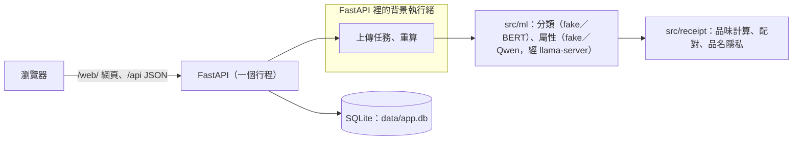

# 啟動與設定細節

給要自己啟動、改設定或重錄展示的人。專案介紹與最短的啟動步驟見 [README](../README.md)。

登入後只有兩個選項：**看自己的品味**、**跟陌生人配對品味**。月報以五個章節呈現品項金額、消費節奏、漂浮文字雲、日期分布與月份比較；配對選人後顯示放大的連線圖與精簡綜合解讀，需要時才展開計算明細。上傳與帳號管理放在右上角設定。

FastAPI 在同一個服務提供網頁與 API，資料保存在本機 SQLite；v2 需啟動服務，GitHub Pages 只提供 [v1 靜態原型](v1-prototype.md)。

## Docker 啟動（建議展示使用）

v2 已合併到 main。用 `git clone https://github.com/lee851104/receipt.git` 取得程式碼後，先安裝並啟動 Docker Desktop（Linux containers），在**專案根目錄**執行：

```powershell
docker compose up --build -d
```

第一次會建置映像並安裝套件（映像檔含 CPU 版 torch，約 1.7 GB），需要網路；預設分類是 `fake`、屬性是 `qwen`，**不下載模型、不需要 GPU 或本機 Python**。不必建立 .env，容器會在資料 volume 產生簽章密鑰。已有 .env 時，Compose 會讀取其中的模型設定；要固定成預設值，可先設定：

```powershell
$env:CATEGORY_MODEL = "fake"
$env:ATTRIBUTES_MODEL = "qwen"
```

開啟 [v2 網頁](http://127.0.0.1:8000/web/) 或 [API 文件](http://127.0.0.1:8000/docs)。健康檢查位於 [api/health](http://127.0.0.1:8000/api/health)。若主機沒有啟動模型服務，`gpu_mode` 為 false，`models.attributes` 為 `cache_only`（只用快取裡的答案，新品名標「待分析」）。

```powershell
docker compose logs --tail=30 app
docker compose down
docker compose up -d
```

日常停止使用 `docker compose down`，再次 up 可恢復；需要保留展示資料時不要加 `-v`。帳號、發票與容器產生的簽章密鑰在 db volume，模型位置在 models volume。Compose 不會把主機或 .env 的 JWT_SECRET 傳入容器。

拉取新程式後用 `docker compose up --build -d` 重建映像。若資料表欄位或索引改變，目前沒有自動資料庫遷移；可在**已備份需要保留的資料，並確認可清空這個展示環境**後，執行 `docker compose down -v`，再執行 `docker compose up --build -d`。這會刪除該專案的 **db 與 models 兩個 volume**，帳號、發票、簽章密鑰與下載模型全部重建，既有登入 token 失效；要保留舊資料時，先由維護者提供遷移方式，不能直接清空。

埠維持綁定 `127.0.0.1`：DEMO_MODE=1 時任何連得到服務的人都能用示範帳號登入。 8000 若已被其他程式占用，可將 docker-compose.yml 的埠映射改成 127.0.0.1:8002:8000，並以 8002 開啟網頁。

**示範帳號（10/18 整合版）：** `DEMO_MODE=1` 時，容器每次啟動都先放入 300 位唯讀示範帳號，連同他們的購買紀錄和品味向量（profile），做完才開始服務；資料已經完整就跳過。在開發電腦上，容器第一次啟動約 17 秒、之後約 6 秒就能用（見[整合驗收](results/integration-acceptance-20261018.md)）。舊 volume 裡只有舊映像檔放的 40 位空帳號時會補到 300 位。第一次啟動做到一半被中斷時，下一次啟動會先把留下的未完成工作標成失敗，再補完示範帳號。放不進去時（例如帳號和示範名單對不上）只記一行 `demo users not updated: ...`，伺服器照常啟動；`DEMO_MODE=0` 時什麼都不放。seed 的訊息說「Delete the database file and run the seed again」時，在 Docker 裡指的是 `docker compose down -v`，會一起刪掉所有帳號、簽章密鑰和下載的模型。示範帳號的屬性答案是審核過的虛構答案（`datasets/synthetic/attribute-cache.jsonl`，放在映像檔裡）；屬性模型版本（`MODEL_VERSION`）改了之後，要等角色 3 把這份答案重新審核成新版本，下一次啟動才會重放，在那之前每次啟動都會記那一行警告，示範品名顯示「待分析」。

## 模型設定與容器連線

設定來源與完整契約見 [團隊總覽第 5.10 節](team/overview.md#510-設定envrepo-只放-envexample)。

- **屬性（`ATTRIBUTES_MODEL`）：** `docker-compose.yml` 和 `.env.example` 的預設是 `qwen`；`Settings` 本身沒設時是 `fake`，已經有的 `.env` 照舊（寫 `fake` 時示範帳號的品名都是「待分析」，要自己改成 `qwen`）。容器預設連到主機的 `http://host.docker.internal:8080`，可用 `DOCKER_LLAMA_SERVER_URL` 覆寫；容器不用 .env 的 `LLAMA_SERVER_URL`，因為主機的 127.0.0.1 在容器內代表容器自身。位址只從設定來，`qwen` 只接受 `http://` 開頭、主機是 `localhost`、`127.0.0.1`、`[::1]` 或 `host.docker.internal`、沒有路徑和密碼的位址，其他位址讓服務啟動時用一行 `error: ...` 停下來（不印位址）。有 llama-server 回應時，上傳和分類輸入框裡的新品名會一個一個送到這個本機服務判斷；連不到時顯示 `cache_only`，只用快取。health 的 `gpu_mode` 表示服務能否連到 llama-server，與 fake/qwen 設定分開。
- **分類（`CATEGORY_MODEL`）：** 預設 `fake`。`bert` 載入 `CATEGORY_MODEL_DIR` 裡已驗證的 BERT 推論包（角色 2，10/18 整合）；資料夾不完整、標籤或雜湊不符時分類器顯示 `unavailable`（即時分類回 503），其餘服務照常。權重不公開：放在受保護的 Hugging Face Space，固定 revision 和 SHA-256。容器第一次啟動要下載時，用 `docker-compose.category.yml` 疊在基本設定上，設 `CATEGORY_MODEL_REPO`、40 位的 `CATEGORY_MODEL_REVISION`、`CATEGORY_MODEL_SHA256` 和 `HF_TOKEN_FILE`（主機上權杖檔的路徑，以唯讀 secret 掛進容器，不進 .env、Git 或映像檔）；`CATEGORY_MODEL_REPO_TYPE` 必須是 `space`，`bert` 加 repo 卻用 `model` 會在啟動時被拒絕。下載失敗時服務照樣啟動，分類器 `unavailable`；已有驗證過的模型時，重啟不需要憑證和網路。只有容器會下載，start.bat 和直接跑 uvicorn 只讀本機資料夾。停止這種疊了 category 設定的專案時，用基本設定就好：`docker compose -p <專案名稱> down`（同時給 `-f docker-compose.category.yml` 卻沒設那幾個變數，Compose 會因為必填變數而報錯）。細節見[分類服務交付](results/classification-service.md)與[審核修正](results/classification-review-fixes.md)。

## Windows Python 啟動

需 Python 3.12（Node 24 僅前端開發／測試需要）。在專案根目錄執行：

```powershell
py -3.12 -m venv .venv
.venv/Scripts/python.exe -m pip install -r requirements.txt
.venv/Scripts/python.exe --version
```

接著雙擊 start.bat；它會在沒有 .env 時從 `.env.example` 建立設定與隨機密鑰（屬性模型為 `qwen`）、放入 300 位示範帳號和他們的購買紀錄與 profile（完整時跳過；上一次被中斷留下的示範工作會先標成失敗再補完），然後開啟 http://127.0.0.1:8000/web/。示範帳號放不進去時只印一行「示範帳號沒有更新：…；繼續啟動伺服器」；設定寫錯時伺服器自己會用一行訊息停下來。保持啟動視窗開啟，停止按 Ctrl+C；已有 .env 不會覆蓋。不要使用 uv sync（pyproject.toml 未列服務套件）。start.bat 固定使用 127.0.0.1:8000；這個埠被別的程式占用時，先關掉那個程式，或改用上面的手動指令並換一個 `--port`。

**示範上傳（10/18 補上）**：start.bat 預設的分類模型是 `fake`，它只認得少數字（茶、咖啡、餅乾、雞蛋、衛生紙…），真實發票的品名大多會被歸到 10「待確認」而不計入，新帳號就會顯示資料不足。示範時可以先產生一份虛構的電子發票 CSV 再從設定上傳：

```powershell
.venv/Scripts/python.exe -m scripts.make_demo_upload --month 2026-06
```

它寫出 `demo-upload-2026-06.csv`（40 行、品名都是審核過的「示範…」名稱，不進 git），上傳後月報就有內容，也配得到示範帳號；換 `--month` 可以多產生幾個月。要分類自己真實的發票，請改用下面的 BERT。

要在虛擬環境用真的 BERT：另外安裝 `requirements-docker.txt`（CPU 版 torch、transformers），把已驗證的推論包放在 `models/category`（或 `CATEGORY_MODEL_DIR` 指的資料夾），再把 .env 的 `CATEGORY_MODEL` 改成 `bert`。start.bat 和 uvicorn 不會下載模型。

若偏好 uv，可用以下方式建立環境並安裝相同依賴：

```powershell
uv venv --python 3.12 .venv
uv pip install --python .venv/Scripts/python.exe -r requirements.txt
```

手動啟動時，先把 .env.example 複製成 .env 並設定至少 32 字元的隨機 JWT_SECRET，再依序執行（僅一個 worker）：

```powershell
.venv/Scripts/python.exe -m src.api.seed
.venv/Scripts/python.exe -m uvicorn src.api.main:app --host 127.0.0.1 --port 8000
```

若出現 No Python at，代表 .venv 指向的基底 Python 不可用，單純看到 Scripts/python.exe 檔案不表示環境可執行。先安裝或修復對應 Python 3.12，再建立新的虛擬環境；開發中的共用 .venv 不要直接刪除。Docker 方式不依賴這個環境。

## 重錄展示與驗證

已有 Playwright／Chromium 的 Node 環境及 Python 服務依賴時：

```powershell
.venv/Scripts/python.exe -X utf8 tests/run_web_v2_live.py scripts/capture_v2_demo.cjs
.venv/Scripts/python.exe scripts/build_v2_demo_gif.py
```

第二行需要 Pillow（可在獨立工具環境安裝）。錄製服務使用臨時資料庫，結束自動關閉；腳本攔截全部 /api/ 請求，中間截圖與 manifest 留在被忽略的 runtime/，成品只有 docs/assets/v2-contract-demo.gif。可用 NODE_PATH、BROWSER_EXECUTABLE 指定既有 Playwright 與 Chromium。

- [向量化、內積、餘弦與收縮項](team/concepts.md)：兩位虛構人物的 +82% 範例，可由 explain API 重現。
- [團隊總覽與 API 契約](team/overview.md)。
- [前後端整合紀錄](results/role4-integration.md)；[本輪展示與 Docker 交付驗收](results/role4-delivery.md)。
- .venv/Scripts/python.exe -m unittest discover -s tests：後端與核心；node --test "tests/*.test.cjs"：前端與 v1。
- .venv/Scripts/python.exe -X utf8 tests/run_web_v2_live.py：隔離 SQLite、fake 模型、真正 HTTP 與瀏覽器流程。
- GitHub Actions 使用 Python 3.12／Node 24，執行測試、建置與檢查容器（映像檔裡沒有私人檔案；compose 啟動後 `models.attributes` 是 `cache_only`、有 300 位示範帳號，第一位和最後一位登入後 profile 都是 ready、沒有待分析品名）；不下載模型。

各角色分支的審核、本機整合（`role-1/integration`）和合併 main 是不同階段；目前狀態見團隊總覽第 13 節。

## 靜態展示版（GitHub Pages）

README 第 1 段的[線上試玩](https://lee851104.github.io/receipt/demo/)是 `demo/` 資料夾：`src/web_v2` 的複本，加上 8 位虛構示範帳號（每種人物類型的 B）預先錄好的 API 回應，不需要伺服器。`demo/static-demo-api.js` 在瀏覽器裡接住網頁的 `/api` 請求，從 `demo/static-demo-data.js` 回答；上傳、改名等寫入一律回「示範帳號唯讀」，和真的服務對示範帳號的回應相同。v1 的 `invoice-insights.html` 不受影響。

前端或示範資料改了之後，先用 start.bat 啟動服務（示範帳號放好），再重建並提交整個 `demo/`：

```powershell
.venv/Scripts/python.exe -m scripts.build_static_demo
```

腳本只錄示範帳號，遇到不是示範帳號的回應會停下來、不寫檔。合併進 main 後 GitHub Pages 才會更新。

## 展示動圖的說明

[九幕介面導覽動圖](assets/v2-contract-demo.gif)是 2026-10-17 新版九幕展示。畫面使用已提交的虛構資料，全部 API 回應由錄製腳本模擬；粉紅底標示展示狀態。這是介面導覽，不代表真模型或 300 人整合驗收。[展示與 Docker 驗收紀錄](results/role4-delivery.md) 另列真實 HTTP 驗證結果。

## v2 架構與技術選擇

v2 把報告做成一個可以註冊、上傳發票並和朋友配對的服務：一個 FastAPI 行程提供網頁和 API，資料存在一個 SQLite 檔。v1 的報告與朋友比較仍是不需要伺服器的單檔網頁（見 [v1 靜態原型](v1-prototype.md)），兩者各自獨立。

### 架構



- 上傳的發票在背景執行緒裡依序處理：品名分類、品項屬性、再算出 18 格品味向量存進資料庫；一次只跑一個任務，所以伺服器只能開一個行程（不要加 `--workers`）。
- 模型都放在 `src/ml` 後面，開發時用 `fake` 假模型就能跑完整流程。`llama-server` 沒開時是無 GPU 模式，沒看過的品名標「待分析」。

### 為什麼沒有用 pgvector

pgvector 是 PostgreSQL 的向量搜尋外掛。這個專題沒有用它，理由記在 `openspec/changes/archive/2026-10-19-add-matching-system/design.md` 的 D2：

- 品味相似度不是單純的餘弦。`compare` 會略過其中一方沒有資料的格子，還要求至少 5 格雙方都有的雙向格才給分數；pgvector 內建的餘弦做不到這兩件事。
- 用它就得多跑一個資料庫服務，每台開發電腦都要裝；SQLite 只有一個檔案。
- 配對在每次查詢時當場算：300 人 × 18 格不到 1 秒，不需要向量索引。

## 角色2 CPU BERT 接入（2026-10-17）

（10/18 已整合，設定與下載方式見上方「模型設定與容器連線」。）角色2分支已接上選定的25%合成BERT；CATEGORY_MODEL=bert搭配可信完整模型目錄，失敗時unavailable。安裝requirements.txt及requirements-docker.txt；公開/Protected政策、白名單安裝與實際驗收詳見[分類服務交付](results/classification-service.md)。原測試集封存，現有服務與主工作目錄未自動切換。
